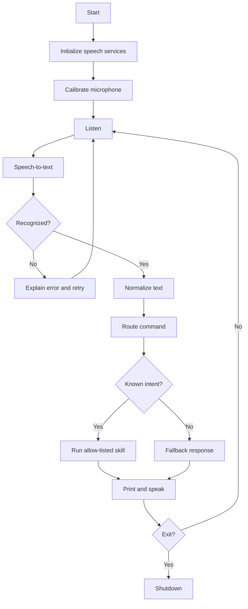

# System Architecture — JARVIS AI

## Components
1. Application runner: startup, calibration, loop, shutdown.
2. Speech input adapter: microphone and speech-to-text.
3. Text normalizer: case, punctuation, whitespace, aliases.
4. Command router: maps recognized intent to a supported skill.
5. Skills: time/date, identity/help, app/site launch, notes, calculator, random number, exit.
6. Speech output: console and Windows SAPI.
7. Local storage: notes and future preferences.
8. Configuration: settings and future API credentials.
9. Tests: unit tests for pure logic and integration tests with mocked I/O.

## Runtime flow


## Safety and error handling
- Never pass recognized speech directly to PowerShell/cmd or unrestricted `eval`.
- Launch only allow-listed apps/sites.
- Restrict arithmetic to numeric constants and approved operators.
- Confirm before future actions that delete/overwrite data, send messages, purchase items, or change settings.
- Handle missing microphone, unclear speech, network failures, invalid arithmetic, and missing notes without crashing.
- Keep current `src/main.py` working while refactoring toward `src/jarvis/` modules.

## Target structure
```text
src/
  main.py
  jarvis/
    speech_input.py
    speech_output.py
    command_parser.py
    command_router.py
    skills/
tests/
  unit/
  integration/
```
This is a target architecture, not a claim that the current single-file implementation already has these modules.
